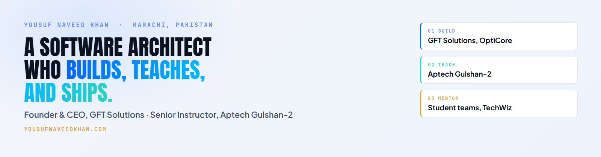
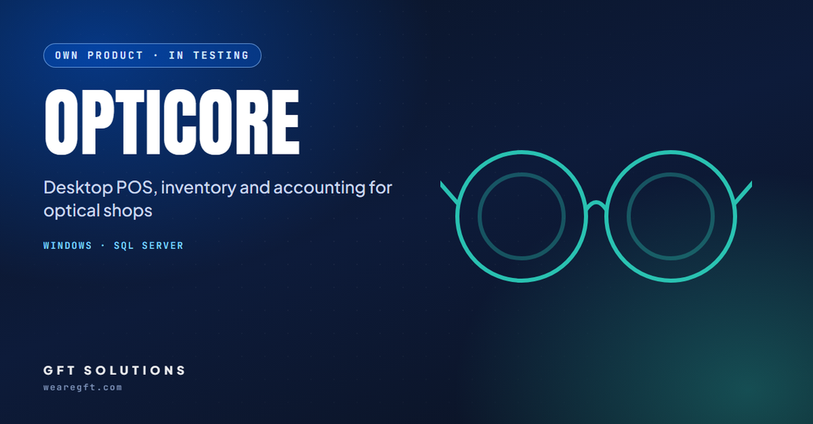
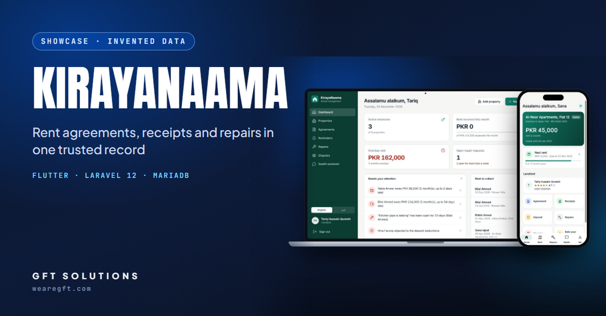
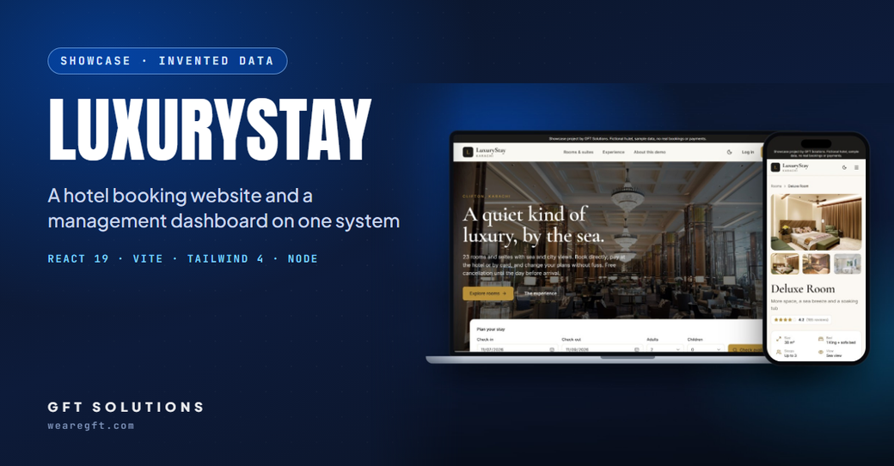
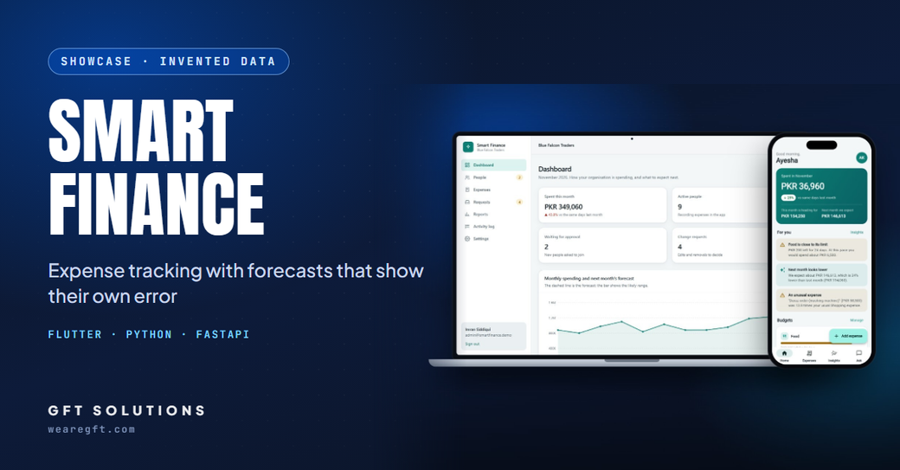

<div align="center">

<picture>
  <source media="(prefers-color-scheme: dark)" srcset="./assets/banner-dark.png">
  
</picture>

</div>

**Yousuf Naveed Khan** is a software architect and educator based in **Karachi, Pakistan**. I am the Founder & CEO of [**GFT Solutions**](https://wearegft.com), a registered software company founded in 2023, and a Senior Instructor at **Aptech Gulshan-2**, where I teach web, mobile, desktop, AI, DevOps and data.

I build business software for B2B clients, and I teach the engineers who will build the next generation of it.

<p align="center">
  <a href="https://yousufnaveedkhan.com"><b>Portfolio</b></a> &nbsp;·&nbsp;
  <a href="https://wearegft.com">GFT Solutions</a> &nbsp;·&nbsp;
  <a href="https://yousufnaveedkhan.com/opticore/">OptiCore</a> &nbsp;·&nbsp;
  <a href="https://www.linkedin.com/in/yousufnaveedkhan/">LinkedIn</a> &nbsp;·&nbsp;
  <a href="https://instagram.com/yousufnaveedkhan">Instagram</a> &nbsp;·&nbsp;
  <a href="https://www.facebook.com/yousufnaveedkhan">Facebook</a> &nbsp;·&nbsp;
  <a href="mailto:yk033127@gmail.com">Email</a>
</p>

---

## At a glance

<table>
<tr>
<td width="34%" valign="top">

### Architect and build

Business software for B2B clients through GFT Solutions: web platforms, desktop systems, mobile apps and AI-assisted workflows.

Founder and product lead of **OptiCore**, a desktop POS, inventory and accounting system for optical shops, now in testing. I also build showcase systems end to end, with tests, to show how I work.

</td>
<td width="33%" valign="top">

### Teach

Senior Instructor at Aptech Gulshan-2: web, mobile and desktop development, AI, DevOps, data analysis and data science. **100+ students taught** over more than two years.

</td>
<td width="33%" valign="top">

### Mentor

Leading and mentoring student project teams, including for **TechWiz** and **Aptech Vision**, from first idea to final presentation.

</td>
</tr>
</table>

## Right now

```text
BUILDING    OptiCore, a desktop POS and accounting system for optical shops
TEACHING    Software engineering and AI at Aptech Gulshan-2
PREPARING   A Machine Learning Engineering track
STUDYING    Dars-e-Nizami, Rabia year
```

## Selected work

My own product, three showcase systems and a payment plugin. **Showcase** means built by GFT Solutions with invented people, places and amounts: not client work and not a live service. Each has screens, a walkthrough video and a case study on my [portfolio](https://yousufnaveedkhan.com/work/).

<table>
<tr>
<td width="50%" align="center">
  <a href="https://yousufnaveedkhan.com/opticore/"></a>
  <br><b>OptiCore</b><br>My own product. Desktop POS, inventory and accounting for optical shops, in testing
</td>
<td width="50%" align="center">
  <a href="https://yousufnaveedkhan.com/work/kirayanaama/"></a>
  <br><b>KirayaNaama</b> (showcase)<br>Rental management: Flutter app in English and Urdu, landlord portal, Laravel API
</td>
</tr>
<tr>
<td width="50%" align="center">
  <a href="https://yousufnaveedkhan.com/work/luxury-stay/"></a>
  <br><b>LuxuryStay</b> (showcase)<br>Hotel booking website and staff dashboard on one API, with transaction-safe room assignment
</td>
<td width="50%" align="center">
  <a href="https://yousufnaveedkhan.com/work/smart-finance/"></a>
  <br><b>Smart Finance</b> (showcase)<br>Expense tracking with forecasts that show their tested error
</td>
</tr>
</table>

**Also:** the [JazzCash MWallet plugin for WooCommerce](https://yousufnaveedkhan.com/work/jazzcash-woocommerce/), a payment method for WooCommerce stores, built with DataLinkk AI. &nbsp;·&nbsp; **[All work, with screens and videos](https://yousufnaveedkhan.com/work/)**

## Working set

| Area | What I work with |
|---|---|
| **Languages** | JavaScript, TypeScript, C#, Python, Dart, PHP, SQL |
| **Web** | React, Angular, Node.js, Express, ASP.NET Core MVC, Laravel, Tailwind CSS, WordPress and WooCommerce |
| **Mobile and desktop** | Flutter, C# and .NET desktop applications |
| **Data** | SQL Server, MySQL, MariaDB, SQLite, MongoDB |
| **AI** | Python, FastAPI, scikit-learn, agentic AI workflows |
| **Cloud and DevOps** | Azure, GitHub Actions |

## Open learning resources

Course material I have built for my students at Aptech, open for everyone. Finished courses are archived (read-only) and stay readable.

| Repository | What it covers |
|---|---|
| [**AgentCraft**](https://github.com/YousufNaveedKhan/AgentCraft) | A 2-month journey from Python fundamentals to building real AI agents, automation pipelines, RAG, tools and memory |
| [**ServerSideProgrammingWithNodeJS**](https://github.com/YousufNaveedKhan/ServerSideProgrammingWithNodeJS) | Lecture-wise notes, tested practical code and assignments for server-side programming with Node.js |
| [**FlutterJourney26-Batch08E_10C**](https://github.com/YousufNaveedKhan/FlutterJourney26-Batch08E_10C) | Flutter and Dart course material for building mobile apps |
| [**WebDesigningCourse26**](https://github.com/YousufNaveedKhan/WebDesigningCourse26) | Lecture-by-lecture HTML, CSS, JavaScript, DOM, events and Bootstrap, written live in class |
| [**ExcelCourse26**](https://github.com/YousufNaveedKhan/ExcelCourse26) | Formatting, formulas, functions, data tools, PivotTables and dashboards, with one practice workbook per lecture |
| [**FullStackApplications**](https://github.com/YousufNaveedKhan/FullStackApplications) | Full-stack web development with Node.js, Express, MongoDB and Mongoose, lecture by lecture |
| [**FrontendDevelopment-with-ReactJS**](https://github.com/YousufNaveedKhan/FrontendDevelopment-with-ReactJS) | React from JSX, props and hooks to routing, forms and effects |
| [**ASP.NET-CORE-MVC-2026**](https://github.com/YousufNaveedKhan/ASP.NET-CORE-MVC-2026) | ASP.NET Core MVC course material, lecture by lecture |
| [**ManagingLargeDatasetsWithMongoDB**](https://github.com/YousufNaveedKhan/ManagingLargeDatasetsWithMongoDB) | CRUD, data types, operators and the aggregation pipeline, with assignments |

## How I work

- **Architecture before code.** Structure, data and permissions first, so the system survives its second year, not just the demo.
- **Teach the why.** Why a technology exists, how it works, when to use it and where it is used.
- **Honest estimates, honest labels.** No shortcuts, no unrealistic promises, and a showcase is always called a showcase.

Rooted in the Qur'an and Dars-e-Nizami, I try to work with *amanah* (trust) and *itqan* (doing it properly).

## Writing

- [Software engineer vs software architect: what is the difference?](https://yousufnaveedkhan.com/insights/software-engineer-vs-software-architect/)

---

<div align="center">

### Let's build something that lasts

Open for B2B software projects with GFT Solutions, OptiCore demos, and teaching or mentoring collaborations.

<a href="https://yousufnaveedkhan.com/contact/?topic=project"><b>Start a project</b></a> &nbsp;·&nbsp;
<a href="https://yousufnaveedkhan.com/contact/?topic=opticore">Request an OptiCore demo</a> &nbsp;·&nbsp;
<a href="mailto:yk033127@gmail.com">Email</a>

</div>
